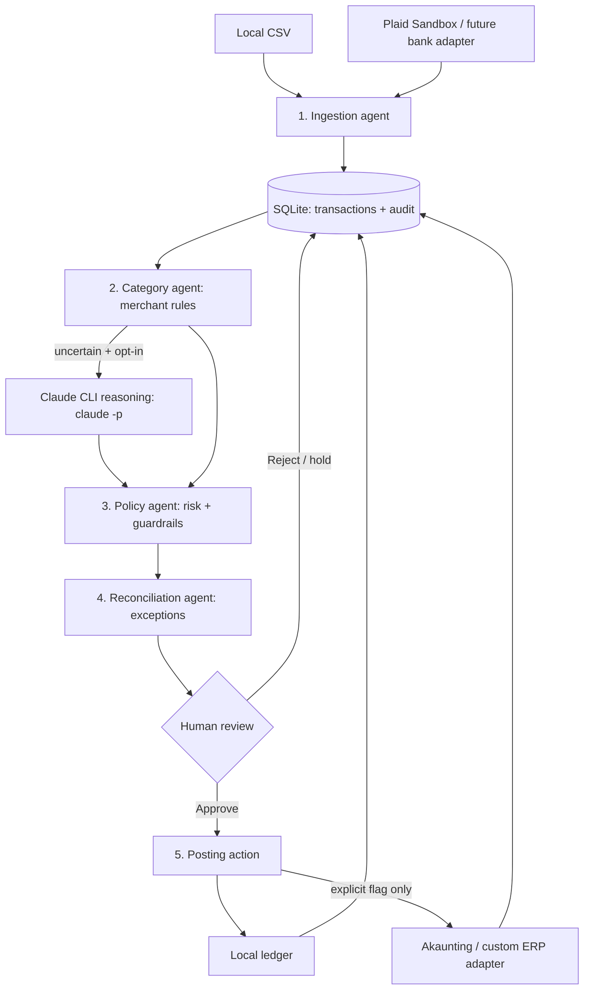

# Workflow and Design Decisions

## Literature Review and Architecture Understanding

Before building the Accounting Agent System, I reviewed standard research on multi-agent systems, tool use, and workflow security.

- **ReAct [1]:** Demonstrated how AI combines reasoning with actions. I used Claude for uncertain expense classification while keeping financial actions controlled by code.
- **AutoGen [2]:** Inspired separating responsibilities into ingestion, categorization, policy checking, reconciliation, and posting.
- **τ-bench [3]:** Highlighted the importance of correct tool execution and policy compliance, motivating human approval before posting.
- **AgentDojo [4]:** Demonstrated security risks in agent workflows, motivating strict guardrails around financial operations.

I also reviewed recent benchmarks focused on real accounting workflows as well:

- **APEX-Accounting [11]:** Accounting task execution, simulated environment and workflow reliability.
- **FinRCA-Bench [12]:** Financial reconciliation and discrepancy detection.
- **FinBalance [13]:** Journal-entry accuracy and accounting consistency.
- **Finch [14]:** Multi-step financial workflow automation.

These showed why accounting agents need reliable execution, reconciliation, and verifiable financial records. 

That led me to choose a controlled hybrid workflow rather than a fully autonomous LLM agent.

## My Architecture

I chose a hybrid multi-agent workflow, where specialized components handle predictable operations and an LLM assists only when reasoning is useful.  

I deliberately avoid auto-paying bills, moving money, filing taxes, or claiming ledger reconciliation without review.

I also examined existing systems such as Akaunting and Plaid [5-10] to understand how accounting records and bank transactions are managed in practice.

This architecture prioritizes control, traceability, extensibility, and reproducibility over agent autonomy. 

It is also lightweight enough to demonstrate locally without connecting a real bank.

## Component diagram

Here, the category agent starts with merchant rules. For uncertain settled expenses, an operator may opt in to a `claude -p` suggestion. Claude cannot approve, post, or call financial tools.

Ingestion, review decisions, and external posting outcomes are stored in SQLite with audit events. And the held or rejected transaction is not posted as an expense. The reconciliation component flags exceptions, it does not claim full bank-to-general-ledger balancing.

The Agents have seperate responsibilities. And Claude only gives structured category reasoning when it is **explicitly** enabled, it has no tool access to begin with. 
The Python code alone controls bank actions, review decisions, and writes. 

## Step-by-step component description

1. **Ingest:** CSV or Plaid sandbox maps transactions into a common schema (stable source ID, account alias, date, amount in USD cents, direction, pending flag). Invalid rows are rejected and replays are idempotent.

2. **Classify:** deterministic merchant rules propose a category with confidence and a short reason. Operator may optionally use claude -p for a second opinion.

3. **Check:** policy holds pending entries, transfers, income, large items ($1,000+) and uncertain items. All other expenses still require review.

4. **Reconcile:** flag bank modifications or removals, transfer candidates, and unknown external posting results, do not silently rewrite approved postings.

5. **Review:** a human selects a category and approves a settled expense. No automated bank movement occurs.

6. **Act:** posting stores the expense locally, or explicitly sends an approved record through the Akaunting/ERP adapter.

7. **Audit/report:** event history and totals are queryable. Posting is never repeated automatically after a network timeout occurs.

## Why these tech stack choices

- **SQLite instead of a full accounting platform:** demonstrates the workflow in seconds and provides durable audit records. Akaunting is an optional system-of-record adapter, not a compulsory dependency.

- **Plaid Sandbox / CSV adapters:** realistic incremental bank sync can be tested without storing actual bank passwords. Real-bank Link authorization, institution compatibility, and production provisioning are intentionally separate tasks.

- **Transport-neutral plugins:** sync(ledger) and post(approved_transaction) are simple extension contracts for other banks, ERPs, spreadsheets or SaaS APIs. External sink credentials stay outside the model prompt.

## Guardrail rules 

1. Categorizer/Claude proposes a human explicitly approves only approved, settled, non-transfer expenses can post.
2. Every source transaction has a stable ID and unique constraint. Revised posted transactions are treated as reconciliation conflicts.
3. Unknown, large or pending expenses are held. An unknown expense can be approved with an explicit human category override and a transfer, pending transaction, or income cannot.
4. An external API failure enters uncertain and a second automatic attempt is prohibited pending manual reconciliation.
5. Claude has no file, shell, browser or bank tools and its structured output is validated and never executed.
6. Currency is restricted to USD. There is no payment initiation or automatic account linking.

## Evaluation 

 Results are written to `artifacts/eval.json` .

| Dimension | Metric (acceptance criterion) | Implemented |
|---|---|---|
| Ingestion correctness | 100% correctly parsed USD examples, 0 invalid rows accepted | Unit tests for money validation |
| Replays / idempotency | 0 duplicate rows or duplicate postings on rerun | Unit tests for two imports, double-post rejection |
| Categorization | Accuracy on a manually labeled merchant sample, aim ≥90% with review | 11 authored examples|
| Safe actions | 0 postings without prior human approval | Unit tests for blocked posting |
| Risk gating | 100% of pending, transfers, income and high-value examples flagged | Unit tests using authored cases |
| Bank changes | 0 silent updates of already posted transactions | Bank-update conflict test |
| External failure | 0 blind retries after ambiguous timeout | Fake failing sink test |
| Provider sync | Incremental paging, cursor replay, removed flagging | Mocked Plaid sandbox API tests, not a live sandbox test |
| Reasoning model safety | Only approved categories no executable model tools | Mocked `claude -p` output validation test |
| Performance | Measure processing time, transactions/min and memory with fixed hardware | Demo runtime in `artifacts/eval.json`(not load test) |
| Explainability | 100% of proposals have category, confidence, rationale, status | Generated proposals and audit rows |

## References

### Research Papers

[1] Yao, S., Zhao, J., Yu, D., Du, N., Shafran, I.,
Narasimhan, K., & Cao, Y. (2023).
**ReAct: Synergizing Reasoning and Acting in Language Models.**
International Conference on Learning Representations (ICLR).
https://arxiv.org/abs/2210.03629

[2] Wu, Q., et al. (2024).
**AutoGen: Enabling Next-Gen LLM Applications via
Multi-Agent Conversation.**
Conference on Language Modeling (COLM).
https://arxiv.org/abs/2308.08155

[3] Yao, S., Shinn, N., Razavi, P., & Narasimhan, K. (2024).
**τ-bench: A Benchmark for Tool-Agent-User Interaction
in Real-World Domains.**
arXiv:2406.12045.
https://arxiv.org/abs/2406.12045

[4] Debenedetti, E., Zhang, J., Balunović, M.,
Beurer-Kellner, L., Fischer, M., & Tramèr, F. (2024).
**AgentDojo: A Dynamic Environment to Evaluate Prompt
Injection Attacks and Defenses for LLM Agents.**
NeurIPS 2024, Datasets and Benchmarks Track.
https://arxiv.org/abs/2406.13352

[5] Benchek, J., et al. (2026).
**APEX-Accounting.**
arXiv:2607.27189.
https://arxiv.org/abs/2607.27189

Public development dataset:
https://huggingface.co/datasets/mercor/apex-accounting

[6] Ghawate, P. (2026).
**FinRCA-Bench: Benchmarking Evidence Retrieval and
Reasoning for Financial AI Systems.**
arXiv:2608.18534.
https://arxiv.org/abs/2608.18534

Code and benchmark:
https://github.com/PratikGhawate/FinRCA-AI-Bench

[7] Tumpati, S., Agarwal, D., Kedia, A., et al. (2026).
**FinBalance: A Multi-Document Accounting
Reconciliation Benchmark.**
arXiv:2606.15949.
https://arxiv.org/abs/2606.15949

Code and dataset:
https://github.com/Devansh1105/finbalance

[8] Dong, H., Zhang, P., Gao, Y., et al. (2026).
**Finch: Benchmarking Finance & Accounting across
Spreadsheet-Centric Enterprise Workflows.**
Findings of ACL 2026, pp. 10768–10794.
https://aclanthology.org/2026.findings-acl.523/

### Integration and Technical Documentation

[9] Plaid. **Transactions Sync — API Reference.**
https://plaid.com/docs/api/products/transactions/

[10] Plaid. **Transactions Sync Migration Guide.**
https://plaid.com/docs/transactions/sync-migration/

[11] Plaid. **Sandbox Documentation.**
https://plaid.com/docs/sandbox/

[12] Akaunting. **RESTful API — Developer Documentation.**
https://akaunting.com/hc/docs/developers/restful-api/

[13] Akaunting. **Bank Transaction Request Validation
— Source Code.**
https://github.com/akaunting/akaunting/blob/master/app/Http/Requests/Banking/Transaction.php
[14] Akaunting. **Open-Source Accounting Platform.**
https://github.com/akaunting/akaunting

