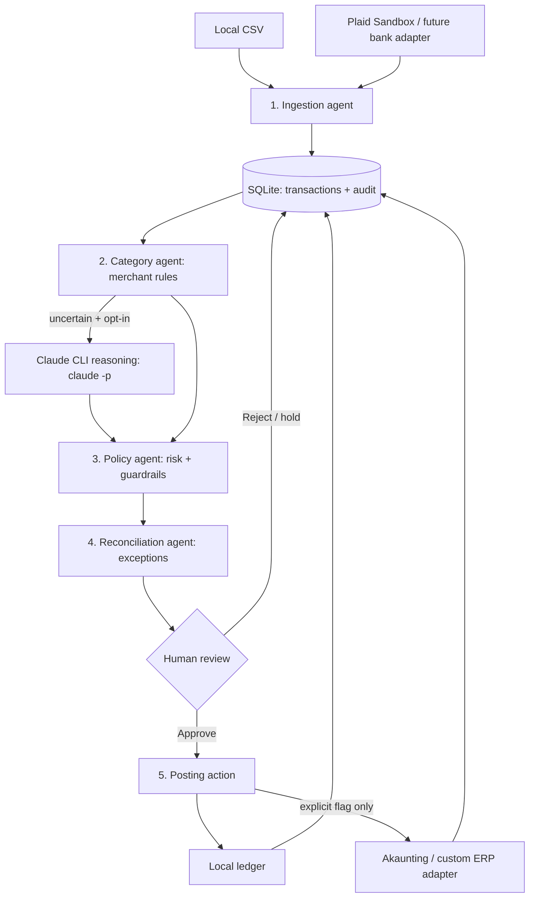

# Workflow and design decisions

## Goal

An owner wants the system to import bank expenses, keep a clean record, and prepare bookkeeping entries. They must remain in charge of posting. We deliberately avoid auto-paying bills, moving money, filing taxes, or claiming ledger reconciliation without review.

## Component diagram

The *agents* are small components with separate responsibilities. Claude **only proposes structured category reasoning** when explicitly enabled; it has no tool access. Python code alone controls bank actions, review decisions, and writes. This is a multi-agent workflow, not four independent chatbots.

## Step-by-step state machine

1. **Ingest:** CSV or Plaid sandbox maps transactions into a common schema (stable source ID, account alias, date, amount in USD cents, direction, pending flag). Invalid rows are rejected; replays are idempotent.
2. **Classify:** deterministic merchant rules propose a category with confidence and a short reason. Unknown merchants may optionally use `claude -p` for a second opinion.
3. **Check:** policy holds pending entries, transfers, income, large items ($1,000+) and uncertain items. *All* other expenses still require review.
4. **Reconcile:** flag bank modifications/removals, transfer candidates, and unknown external posting results; do not silently rewrite approved postings.
5. **Review:** a human selects a category and approves a settled expense. No automated bank movement occurs.
6. **Act:** posting stores the expense locally, or explicitly sends an approved record through the Akaunting/ERP adapter.
7. **Audit/report:** event history and totals are queryable. Posting is never repeated automatically after a network timeout.

`ingested → review/held → approved → posted` is the normal state machine. For an external write, `approved → posting → posted/uncertain`. An `uncertain` external write requires manual reconciliation, because a timeout might have happened after the receiving system committed the transaction.

## Why these choices

- **SQLite instead of a full accounting platform:** demonstrates the workflow in seconds and provides durable idempotency/audit records. Akaunting is an optional system-of-record adapter, not a compulsory dependency.
- **Plaid Sandbox / CSV adapters:** realistic incremental bank sync can be tested without storing actual bank passwords. Real-bank Link authorization, institution compatibility, and production provisioning are intentionally separate tasks.
- **Rules first; Claude only when uncertain:** transparent and cheap for recurring vendors; Claude supplies flexibility for unfamiliar descriptors. The model produces a suggestion, never an action or approval.
- **Human approval:** categories, counterparties and tax treatment can be wrong; bookkeeping effects must not rely on untrusted model text alone.
- **Transport-neutral plugins:** `sync(ledger)` and `post(approved_transaction)` are simple extension contracts for other banks, ERPs, spreadsheets or SaaS APIs. External sink credentials stay outside the model prompt.

## Security boundaries

- No card or bank login collection. Bank integration uses provider access tokens in **environment variables** (use a proper secret store in production).
- Avoid passing account references, source IDs, full history, or credentials to Claude; only minimal merchant/amount for uncertain cases. Do not opt in when sensitive transaction data cannot leave the machine.
- Claude calls have tools and MCP access disabled. Merchant strings are untrusted data, and model outputs are parsed against an allowlist.
- Postgres + per-user authorization, proper at-rest encryption, audit retention, verified bank webhooks, backups and disaster recovery are **production upgrades**, not implemented guarantees.
- USD only; avoid silent currency conversion or inappropriate accounting rounding. No tax, payroll, journal balancing or legal compliance claims.

## Integration references

- [Plaid Transactions Sync](https://plaid.com/docs/transactions/): cursor paging, modified and removed transactions, `SYNC_UPDATES_AVAILABLE` webhooks.
- [Plaid Sandbox](https://plaid.com/docs/sandbox/): test items and transaction simulation.
- [Akaunting API](https://akaunting.com/hc/docs/developers/restful-api/) and [request validation](https://github.com/akaunting/akaunting/blob/master/app/Http/Requests/Banking/Transaction.php): API authentication and transaction fields; deployment-specific settings must be verified.
- [Claude CLI](https://code.claude.com/docs/en/cli-reference): noninteractive `claude -p`, with tools disabled.
